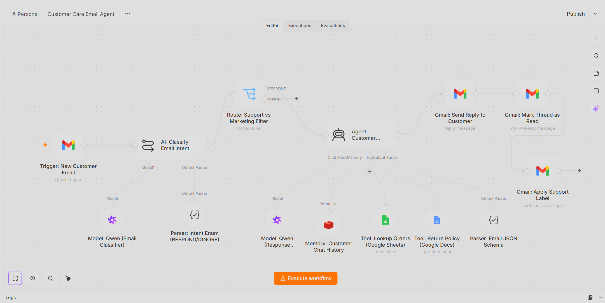
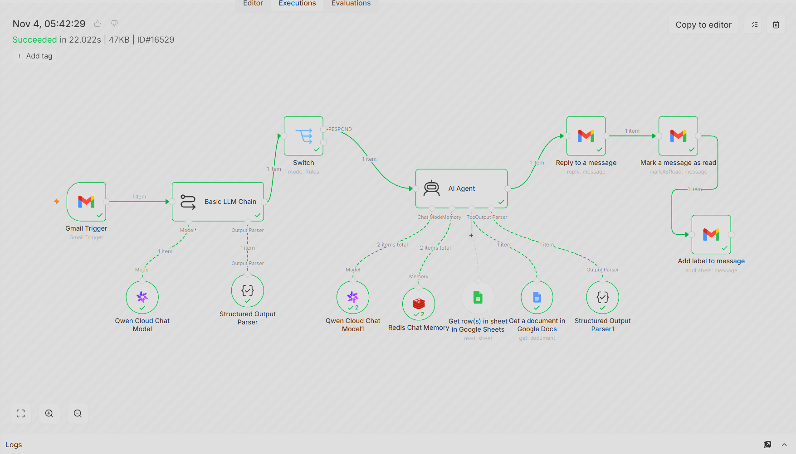

# 🤖 AI Customer Care Email Agent: Autonomous Support & CRM Automation

An enterprise-grade, 100% autonomous customer support system orchestrated in **n8n**. This AI-powered agent completely automates inbound email processing by intelligently classifying messages, filtering out marketing spam, retrieving live order details from Google Sheets, checking company return policies via Google Docs, and drafting context-aware, personalized replies via Gmail—all securely running on a **self-hosted Docker infrastructure on a local server**.

---

## 🌟 Executive Summary
Customer support teams spend countless hours filtering spam and looking up order statuses manually. This workflow introduces an intelligent **AI Support Specialist Agent** powered by **Alibaba Cloud Qwen LLMs**. It scans unread Gmail messages every minute, separates legitimate support queries from marketing emails, queries internal business databases dynamically, and automatically sends polite, professional plain-text responses while updating email labels and read statuses. All backend processing and API operations are securely isolated within a local Dockerized environment.

---

## 🖼️ System Architecture & Execution Proofs

### 1. Core n8n Workflow Architecture
*The complete multi-agent orchestration canvas showing Gmail triggers, Qwen intent classification, routing switches, and operational tool nodes:*

### 2. Successful Pipeline Execution
*Live execution logs showing successful data flow, green ticks across all nodes, and automated response delivery:*

---

## ⚙️ Core Tech Stack & AI Models

### 1. Infrastructure & Orchestration
- **Engine:** n8n (Self-Hosted via Docker Desktop on Local Server Environment)
- **Memory Buffer:** Redis Chat Memory (`Memory: Customer Chat History`) for maintaining contextual threads per customer.
- **Trigger:** Gmail Trigger (Polls unread customer support threads every minute).

### 2. AI Intelligence & Models
- **Intent Classifier:** Alibaba Cloud Qwen (`qwen3.7-flash`) paired with structured JSON enums (`RESPOND` vs `DO_NOT_RESPOND`).
- **Support Agent Brain:** Alibaba Cloud Qwen (`qwen3.7-plus`) configured as a LangChain ReAct agent.
- **Output Parser:** Structured JSON schema enforcing clean email subjects and plain-text message bodies.

### 3. Enterprise Tools & Integrations
- **Order Lookup:** Google Sheets API (`Tool: Lookup Orders`) for fetching live customer order statuses, delivery dates, and shipping info.
- **Policy Verification:** Google Docs API (`Tool: Return Policy`) for retrieving accurate refund, return, and exchange timelines.
- **Action Layer:** Gmail API (Automated replies, marking threads as read, and applying custom support labels).

---

## 🚀 The Automated Agent Flow

1. **Email Ingestion:** The `Gmail Trigger` monitors unread incoming customer messages in real-time.
2. **Intent Classification:** The Qwen classifier analyzes the email body and subject, routing genuine requests (`RESPOND`) while ignoring marketing spam (`IGNORE`).
3. **Multi-Tool Agent Reasoning:** 
   - If an order status is requested, the agent invokes the **Google Sheets Tool**.
   - If a return or refund policy question arises, the agent queries the **Google Docs Policy Tool**.
4. **Contextual Response Generation:** The agent formulates a professional, empathetic response following strict plain-text formatting guidelines (avoiding Markdown or unauthorized complaint-processing claims).
5. **Post-Processing & Delivery:** The system replies directly to the customer via Gmail, marks the thread as read, and attaches the appropriate support label for human oversight if needed.

---

## 👨‍💻 Engineering Highlights & Problem Solving

- **Secure Dockerized Local Deployment:** Fully hosted on a self-hosted local Docker container, guaranteeing absolute data confidentiality for sensitive customer communications, service-account credentials, and internal store records without relying on expensive external SaaS clouds.
- **Advanced Intent Filtering:** Eliminated false positives by decoupling missing data (such as a missing Order ID) from classification, ensuring customers asking "Where is my order?" are correctly routed to support instead of being dropped.
- **Structured JSON Schema Enforcements:** Utilized rigid LangChain output parsers to guarantee reliable communication between the LLM agent and the downstream Gmail reply nodes, preventing malformed payloads.

---
*Architected and Developed by **Abu Bakar Siddique** (@hafiz-abubakar-dev) — AI Automation Engineer*
